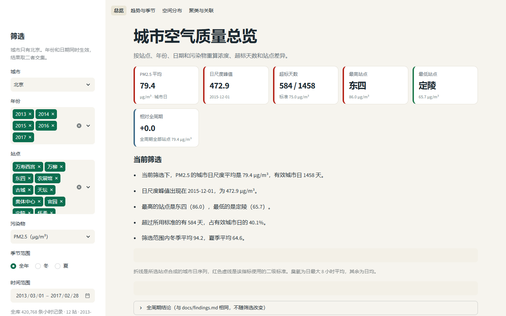
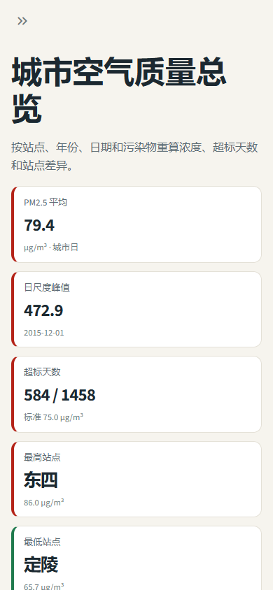
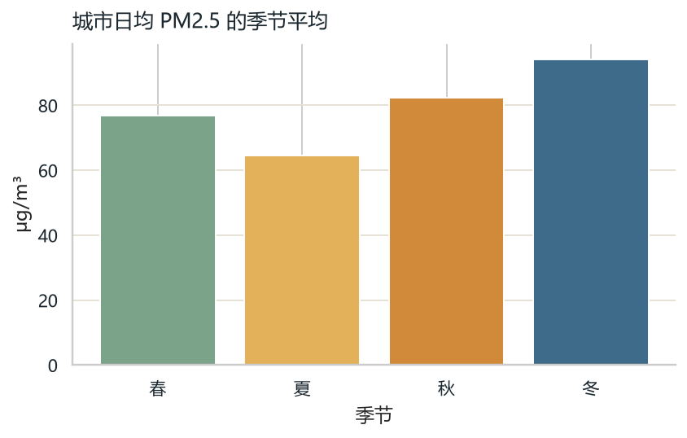
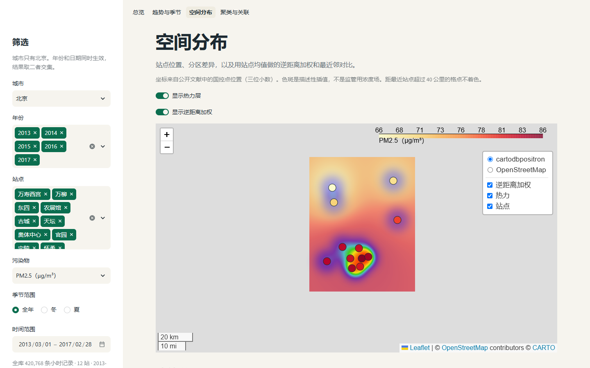
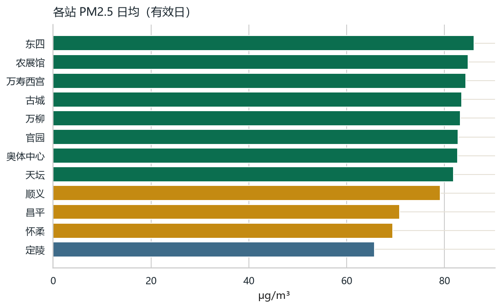
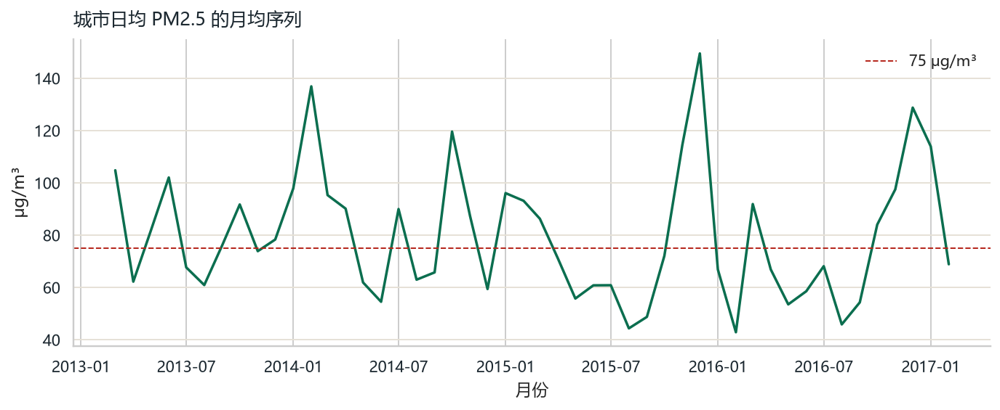
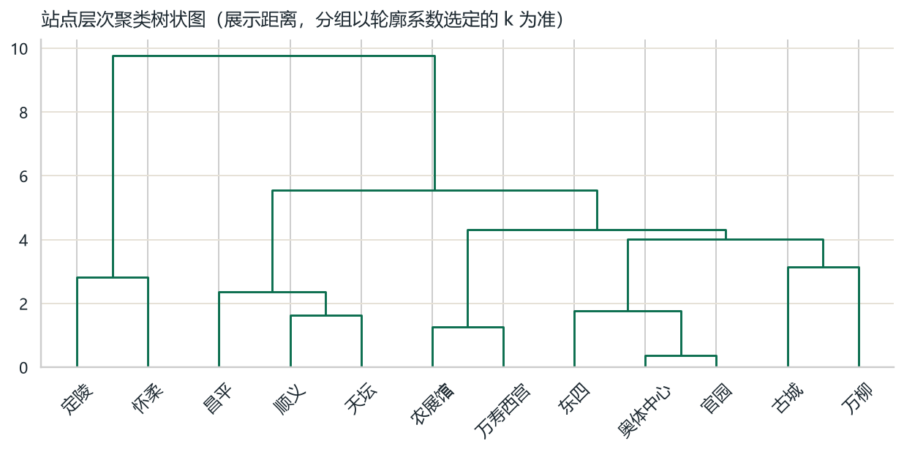

# 中国城市空气质量时空分析

面向空间数据分析的训练项目。仪表盘有两层，尺度不能混用：

- **全国监测城市，日尺度，2023-01-01 至 2024-12-31。** 城市代表点地图、区域与季节、Moran’s I / LISA、按时间切开的表格回归。
- **北京 12 个国控站，小时尺度，2013-03-01 至 2017-02-28。** 原来的趋势、季节、站点空间插值和聚类仍然保留。

全国全部有效城市日的 PM2.5 平均是 **31.2 μg/m³**（247174 个城市日）。冬季 **48.4**，夏季 **17.2**，冬夏比 **2.81**。北京全周期城市日均是 **79.4**，那是另一套年份、另一种空间单元，不能和 31.2 相减。

监测表不是图像。没有许可清楚、并且自带标注的公开图像，所以仪表盘**没有 YOLO 页面**，也不报告检测框、mAP 或训练曲线。原因写在面试备忘里。

本地演示：

```powershell
.\.venv\Scripts\python.exe -m streamlit run app.py
```

打开 http://localhost:8501 。全国四页在「全国城市」，北京四页在「北京站点」。尚未部署，本 README 不提供在线地址。



本地窄屏下指标卡改为上下排列，侧栏收起：



## 全国城市：数据从哪来

- 日文件：<https://quotsoft.net/air/> 上的 `china_cities_YYYYMMDD.csv`。上游是中国环境监测总站全国城市空气质量实时发布平台。
- 发布页写明欢迎分析研究，**没有 SPDX 许可证**。原始逐小时宽表不进版本库，只保留聚合后的 parquet。
- 本仓库实际使用 **2023-01-01 至 2024-12-31**。文件里有 **730** 天，缺 **2023-10-02** 这 1 天。
- 小时表里的城市名 **375** 个，对上坐标的 **371** 个。没对上、因此不进地图和 Moran 的是：兰州新区、胶南、西咸新区、赣江新区。
- 坐标来自和风天气公开城市列表 [China-City-List-latest.csv](https://github.com/qwd/LocationList/blob/master/China-City-List-latest.csv)。列表页没有单列坐标系名称。北京点（约 39.905°N, 116.405°E）与常见 WGS84 城市中心在数百米内，分析按 **WGS84 城市代表点** 使用，不是监测站坐标。
- 一天至少 **18** 个有效小时才进入日均。负值和明显哨兵值丢掉。CO 是 **毫克/立方米**。臭氧是小时浓度的日均，**不是**日最大 8 小时。AQI 是小时 AQI 的日均，**不是**正式日 AQI。
- 不覆盖县、乡、镇。点的支撑是监测城市。

重做全国聚合（需要联网，大约两年的逐日文件）：

```powershell
.\.venv\Scripts\python.exe scripts\prepare_national.py
```

脚本按月断点续下，写到 `data/raw/national_parts/`（已在 `.gitignore`），再生成 `data/processed/national_city_day.parquet` 等，并更新 `outputs/national_summary.json` 与 `docs/findings.md` 里全国那一节。

## 全国城市：可以引用的结果

数字来自 `outputs/national_summary.json`，解释在 [docs/findings.md](docs/findings.md)。

1. 达到天数门槛的城市先各自平均、再对城市等权，PM2.5 是 **31.1 μg/m³**。城市日超过 75 μg/m³ 的有 **15100** 天，占 **6.1%**。75 是 GB 3095-2012 二级 24 小时浓度的参照，不是正式评价。
2. 有效天数不少于 200 天的城市里，平均最高的是和田地区（新疆，**88.6**，724 天），最低的是阿里地区（西藏，**6.0**，724 天）。
3. 区域是事先划定的，不是聚类。珠三角只含广州、深圳、佛山、东莞、中山、珠海、惠州、江门、肇庆这 **9** 城，城市日均 PM2.5 **20.5**。华北 **34.5**（37 城），长三角 **32.5**（41 城），成渝 **31.9**（四川和重庆，22 城），西北 **34.7**（53 城）。没有人口加权。
4. 2023 年城市日均 **32.0**，2024 年 **30.4**，相差 **-1.6**。这是城市日等权，不是人口加权，也不是政策评估。
5. 全局 Moran’s I：k=8 行标准化近邻，n=339，**I=0.589**，期望 **-0.003**，999 次置换的双侧 **p=0.001**（计数从 0 起时，p 的下限是 1/1000，不写成 0）。400 公里反距离权重 **I=0.679**（n=337，去掉 2 个孤立点）。冬季 I=**0.621**，夏季 I=**0.381**。
6. LISA（α=0.05，p 未校正）：高-高 **56**，低-低 **47**，高-低 **0**，低-高 **2**，不显著 **234**。
7. 预测当日城市 PM2.5。特征只有昨日、7 日前、邻近城市昨日、月份正余弦、星期和代表点坐标，没有当天的其他污染物，也没有气象。时间切分点 **2024-06-28**。测试 MAE **8.02**、RMSE **13.72**；持久性基线（直接用昨天）MAE **8.31**、RMSE **14.29**。MAE 相对基线只小了约 **3.5%**（变化比例 0.035）。置换重要性里，昨日 PM2.5 打乱后 MAE 增加 **5.972**，其余特征远小于它。
8. 全国没有做 IDW，也没有做克里金。城市点间距经常超过 100 公里，插成连续面会被看成街道尺度的污染场。北京 12 站仍保留 IDW，格点距最近站超过 40 公里不着色。

个别自治州在源表里同时有简称列和全称列。2023–2024 里「甘孜州」「黔东南州」的 PM2.5 全为空，有数值的是「甘孜藏族自治州」「黔东南苗族侗族自治州」。均值和 Moran 用的是有数值的列。

## 页面

| 分组 | 页面 | 做什么 |
| --- | --- | --- |
| 全国城市 | 总览 | 省份、城市、指标、季节、日期；指标卡和城市代表点地图 |
| 全国城市 | 区域与季节 | 事先划定的区域对比 |
| 全国城市 | 空间关联 | 全样本 Moran’s I 和 LISA；筛选只改地图上的城市 |
| 全国城市 | 城市预测 | 时间切分后的测试误差，以及单城曲线 |
| 北京站点 | 总览、趋势与季节、空间分布、聚类与关联 | 原来的 12 站小时分析 |

空筛选会给出中文说明，而不是空白图。窄屏下卡片改成单列。Moran、LISA 和模型标题数字是全样本结果，页面上有说明，不会跟着某一个省份的筛选改写成另一套检验。

## 北京 12 站

全周期城市日均 PM2.5 为 **79.4 μg/m³**。冬季 **94.2**，夏季 **64.6**，冬季是夏季的 **1.46** 倍。完整年份里，2016 年（71.8）比 2014 年（84.5）低 12.7 μg/m³。


本地窄屏下指标卡改为上下排列，侧栏收起：


本地演示：安装依赖后运行 `streamlit run app.py`，打开 http://localhost:8501 。处理后的数据已在仓库里，不必先下载。  
在线链接：尚未部署。

## 北京数据来源

- 数据集：[Beijing Multi-Site Air-Quality Data](https://archive.ics.uci.edu/dataset/501/beijing+multi+site+air+quality+data)，UCI，DOI [10.24432/C5RK5G](https://doi.org/10.24432/C5RK5G)
- 论文：Zhang 等，2017，*Cautionary tales on air-quality improvement in Beijing*，Proceedings of the Royal Society A
- 时段：2013-03-01 00:00 至 2017-02-28 23:00，12 站 × 35064 小时 = 420768 条
- 污染物：PM2.5、PM10、SO2、NO2、CO、O3（μg/m³）
- 气象：气温、气压、露点、降水、风向、风速
- 字段、站点坐标和清洗规则见 [docs/data-dictionary.md](docs/data-dictionary.md)

处理后的 `data/processed/hourly.parquet` 与 `daily.parquet` 随仓库提供，克隆后即可打开仪表盘。原始压缩包和 CSV 仍不进入版本库。若要按 UCI 原始文件重新清洗，再运行 `python scripts/prepare_data.py`，它会下载压缩包并覆盖这两份 parquet。

## 复现步骤

在项目根目录执行。Windows 可以用 PowerShell。

```powershell
python -m venv .venv
.\.venv\Scripts\python.exe -m pip install -r requirements.txt
.\.venv\Scripts\python.exe -m streamlit run app.py
```

仓库里已经有：

- `data/processed/hourly.parquet`、`daily.parquet`（约 7.3 MB + 0.6 MB）
- `outputs/figures/` 下的静态图
- `docs/findings.md` 与 `outputs/analysis_summary.json`

要从原始压缩包重做清洗时，再运行 `.\.venv\Scripts\python.exe scripts\prepare_data.py`。这一步需要联网下载，原始包仍只留在本地。

测试（不下载数据）：

```powershell
.\.venv\Scripts\python.exe -m pytest -q
```

北京站点侧栏可以改年份、站点、污染物、季节范围和日期。臭氧的日序列和超标用日最大 8 小时平均，日变化图仍用小时浓度。没有选站点、没有有效日，或地图组件失败时，页面给出空状态或错误说明，而不是空白图。

面试备忘（嵌入微软雅黑）：

```powershell
.\.venv\Scripts\python.exe scripts\build_interview_pdf.py
```

写出 `docs/must-spatial-big-data-interview.pdf`。里面的全国数字和北京数字分别来自两份 JSON，不混用。

## 结果与结论

下面的数字来自清洗后的全库计算，完整列表和表格在 [docs/findings.md](docs/findings.md)。日均值要求当天至少 18 个有效小时；城市日至少 8 个站点有效。2013 与 2017 不是完整年，年均比较只用 2014–2016。

1. 冬季城市日均 PM2.5 为 94.2 μg/m³（359 天），夏季为 64.6 μg/m³（368 天），冬季是夏季的 1.46 倍。跨年平均后，最高的月份是 12 月（103.9），最低是 8 月（53.5）。
2. 2014 年城市日均 PM2.5 为 84.5 μg/m³（363 天），2016 年为 71.8 μg/m³（365 天），低 12.7 μg/m³（-15.0%）。
3. 全周期 1458 个有效城市日里，日均超过 75 μg/m³ 的有 584 天（40.1%），超过 150 μg/m³ 的有 174 天（11.9%），并成 84 次重度过程。峰值最高的一次是 2015-11-27 至 2015-12-01，峰值日 2015-12-01 的城市日均是 472.9 μg/m³；这一天 12 个站都有 24 小时数据，站日均落在 379.7 到 519.8 之间。
4. 这些重度过程按持续天数加权的平均风速是 1.21 m/s，全部有效城市日是 1.73 m/s。过程期间平均露点 1.31 °C，全周期是 2.48 °C。城市日尺度上，PM2.5 与风速 r=-0.43（n=1458），与露点只有 r=0.08。能稳定看到的是风速偏低与高污染同现，不是露点越高污染越高。
5. 站点日均 PM2.5 最高是东四（86.0），最低是定陵（65.7）。层次聚类取 k=2（轮廓系数 0.453）：定陵、怀柔为较低组，其余 10 站为较高组。留一法里，逆距离加权 RMSE 3.81，最近邻 4.73。这只说明长期平均在站点之间比较平滑，不能当成小时污染地图。











其他污染物的城市日尺度平均（臭氧为日最大 8 小时平均）：PM10 104.5、SO2 15.8、NO2 50.5、CO 1228、O3 99.9。SO2 没有城市日超过 150 μg/m³；PM2.5、PM10、NO2、CO、O3 的超标天数见 findings 里的表。

小时平均的 PM2.5 在 22 时最高（89.0），7 时最低（73.3）。工作日城市日均 77.6，周末 83.8。

## 局限与致谢

- 短缺口才线性插值（连续不超过 6 小时，整段更长的不补）。插值前 PM2.5 缺失率 2.09%，插值后 1.06%。降水和风向不插值。
- 约 4.97% 的成对小时里 PM2.5 高于 PM10，已保留，没有当成异常删除。
- 日序列有自相关，相关和季节差只作描述。
- 空间插值使用文献中的站点坐标，格点距最近站点超过 40 公里不着色。
- 标准对照的是 GB 3095-2012 二级限值，用来给筛选结果一个参照，不是正式评价报告。

交互形式借鉴了 Febrianss 的公开项目 [beijing-prsa-2019](https://github.com/fbrianzy/beijing-prsa-2019)（MIT License, Copyright (c) 2026 Febrianss）。本仓库的清洗、指标、页面和结论文案是单独写的，没有复制该仓库源码。

方法顺序上参考了 Himat Shah（[adeelshah110](https://github.com/adeelshah110)，公开资料为芬兰 Centria 应用科学大学的讲师与研究者）公开仓库里的做法：先把序列按时间排好再做预测，模型要有简单基线，检测模型只用于图像而不是表格浓度，页面在窄屏上把字号和卡片收一步。那些仓库里没有见到许可证文件，所以这里只致谢方法，不复制源码或 README。

## 在线演示

尚未部署，本 README 不提供在线地址。北京小时 parquet、2023–2024 全国城市日 parquet，以及另一份 2016–2025 城市日 parquet，都在 `data/processed/`。原始逐小时城市文件和压缩包不进入版本库。

2016–2025 那一份的口径写在 [docs/china-findings.md](docs/china-findings.md)：391 个城市名，387 个对上代表点；同一批城市的年平均 PM2.5 从 2016 年 47.2 到 2025 年 30.3 μg/m³（315 城，每年至少 240 个有效日）。仪表盘全国页仍用 2023–2024，因为 Moran 敏感性、LISA 和置换重要性是按这一套算的。两套数字不要相减。
